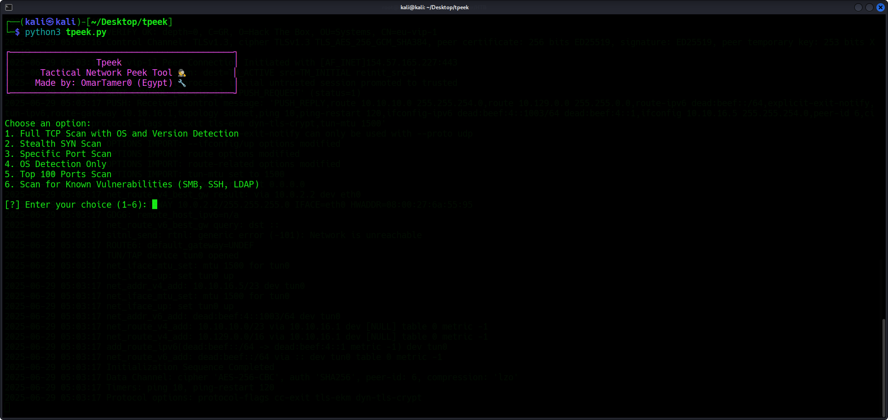
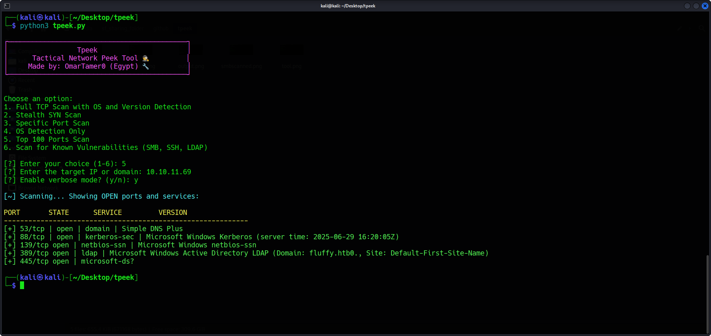

# Tpeek

🕵️ **Tpeek** — Tactical Network Peek Tool  
🔧 Developed by: **[Omar Tamer](https://github.com/Omar-tamerr)** (Egypt)

---

## 🌟 What is Tpeek?

**Tpeek** is a menu-driven Python wrapper around Nmap.  
It helps penetration testers, red teamers and network admins run the scans they use most (full TCP, stealth SYN, top ports, OS detection, service vulnerability scripts) without remembering every flag, with live color-coded output and timestamped results saved for the report.

---

## 🧠 Features

- 🔍 **Full TCP Scan** (all ports + version detection)
- 🥷 **Stealth SYN Scan** (`-sS`)
- 🌟 **Specific Port Scan**
- 🧠 **OS Detection**
- 🚀 **Top 100 Ports Scan**
- 🛡️ **Vulnerability Enumeration for SMB, SSH, LDAP**
- 🎨 **Color-coded live output**
- 🗒️ **Saved scan results with timestamps**
- ✨ **Minimalist CLI UI**

---

## ⚙️ Usage

```bash
chmod +x tpeek.py
./tpeek.py
```

You'll see a menu like this:

```
Choose an option:
1. Full TCP Scan with OS and Version Detection
2. Stealth SYN Scan
3. Specific Port Scan
4. OS Detection Only
5. Top 100 Ports Scan
6. Scan for Known Vulnerabilities (SMB, SSH, LDAP)
```

Example:
```bash
# Scan 10.10.10.10 stealthily
./tpeek.py
# Select option 2, enter target IP
```

---

## 📂 Output

All scans are saved under the `scan_results/` folder with filenames like:

```
top_ports_10.10.10.10_2025-05-24_19-30-00.txt
```

---

## 📸 Screenshots

### 🔧 Menu Interface


### 📋 Top Ports Example Output


---

## 🧑‍💻 Requirements

- Python 3.6+
- Nmap (must be installed on your system)

Install Nmap:
```bash
sudo apt install nmap
```

---

## ⚖️ Authorized Use Only

Use this tool only on systems you own or have **written permission** to test, such as a
signed penetration-testing scope or your own lab. Unauthorized access to computer systems
is illegal. The author accepts no liability for misuse.

---

## 👑 Author

**Omar Tamer** · [GitHub](https://github.com/Omar-tamerr) · [LinkedIn](https://www.linkedin.com/in/omar-tamer-ot/) · [TryHackMe](https://tryhackme.com/p/OmarTamer0)  
🌍 Egypt

---

## 📜 License

MIT License — see [LICENSE](LICENSE).

---

> “Tpeek — Don’t just scan. Peek tactically.” 🔍

